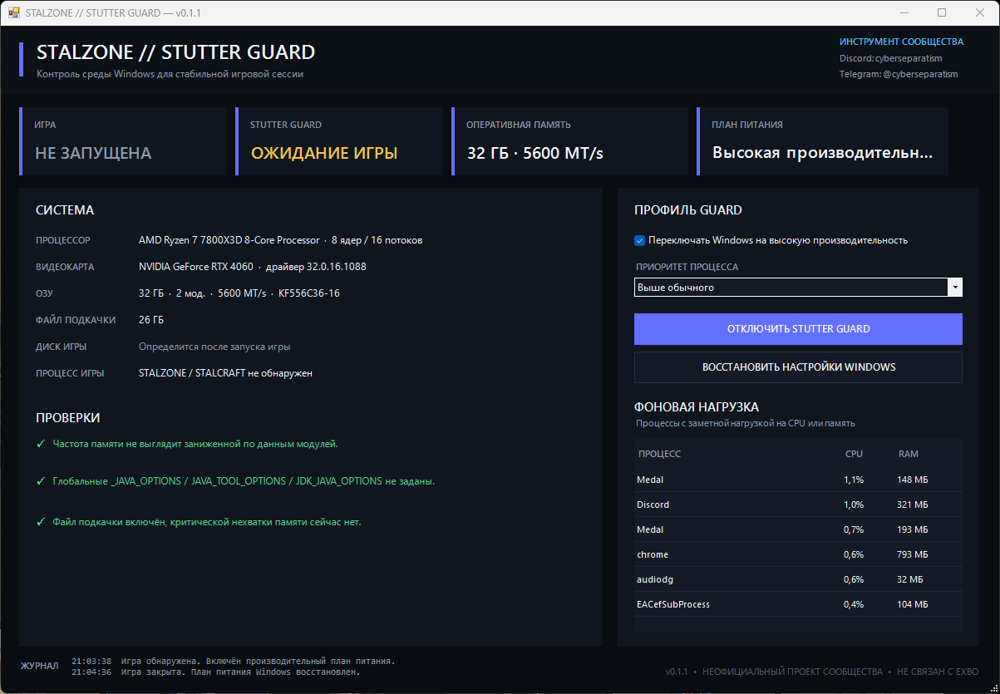

# STALZONE // STUTTER GUARD

Windows-утилита для диагностики системного окружения и применения аккуратного игрового профиля во время STALZONE / STALCRAFT.

Stutter Guard не меняет файлы игры, не внедряется в процесс и не читает память клиента. Всё работает через обычные средства Windows и PowerShell.



> [!IMPORTANT]
> Проект не связан с EXBO и не является официальным инструментом STALZONE / STALCRAFT. Программа не гарантирует прирост FPS: её задача — убрать часть системных причин нестабильности и быстро показать подозрительные места в конфигурации.

## Возможности

- автоматическое обнаружение запущенного STALZONE / STALCRAFT;
- отображение CPU, GPU, RAM, файла подкачки и диска игры;
- проверка фактической частоты оперативной памяти;
- предупреждение о возможном отключённом XMP / EXPO для поддерживаемых форматов маркировки модулей;
- проверка `_JAVA_OPTIONS`, `JAVA_TOOL_OPTIONS` и `JDK_JAVA_OPTIONS`;
- список заметных фоновых процессов по CPU и памяти;
- временное переключение Windows на план высокой производительности;
- выбор приоритета процесса игры: обычный, выше обычного или высокий;
- восстановление исходного плана питания после закрытия игры;
- попытка восстановить сохранённый план питания после некорректного завершения программы.

## Требования

- Windows 10 или Windows 11;
- Windows PowerShell 5.1+.

Никакие драйверы, службы или сторонние runtime-пакеты не устанавливаются.

## Установка

1. Откройте раздел **Releases**.
2. Скачайте `STALZONE-Stutter-Guard-v0.1.2.zip`.
3. Распакуйте архив.
4. Запустите:

```text
Start-StutterGuard.cmd
```

## Как пользоваться

1. Запустите Stutter Guard.
2. Проверьте блок **Система** и предупреждения.
3. Оставьте приоритет **Выше обычного**, если нет причины менять его.
4. При необходимости оставьте включённым переключение на высокую производительность.
5. Нажмите **Включить Stutter Guard**.
6. Запустите игру.

После обнаружения игры программа применит выбранный профиль. Когда игровой процесс завершится, исходный план питания Windows будет восстановлен.

## Что именно меняется

При включённом Guard программа может временно:

- переключить активный план питания Windows на `High performance`;
- изменить `PriorityClass` процесса игры.

Остальные проверки являются диагностическими и сами ничего в системе не меняют.

## Приоритет процесса

По умолчанию используется **Выше обычного (`AboveNormal`)**.

Режим **Высокий (`High`)** оставлен как ручная настройка. Он не является универсальным «ускорителем» и на некоторых системах может ухудшить отзывчивость фоновых процессов.

## Проверка оперативной памяти

Stutter Guard получает текущую частоту через `Win32_PhysicalMemory`.

Для некоторых распространённых форматов part number программа также пытается определить заявленную скорость модуля. Например, для:

```text
KF3200C16D4/16GX
```

при работе памяти на 2400 MT/s появится подсказка проверить XMP / EXPO в BIOS.

Это только диагностика. Программа не меняет настройки BIOS.

## Java-переменные

Проверяются:

```text
_JAVA_OPTIONS
JAVA_TOOL_OPTIONS
JDK_JAVA_OPTIONS
```

Если одна из них задана глобально, Stutter Guard покажет предупреждение. Значения не удаляются и не изменяются автоматически.

## Фоновая нагрузка

В правой части окна показываются процессы с заметной текущей нагрузкой на CPU или память. Несколько процессов с одинаковым именем объединяются в одну строку.

Это помогает быстро заметить браузер, запись экрана, антивирус, оверлей или другое приложение, которое забирает ресурсы во время игры.

## Безопасность

Stutter Guard специально не делает агрессивные «оптимизации»:

- не отключает Microsoft Defender;
- не меняет HPET и системные таймеры;
- не отключает ядра процессора;
- не меняет CPU affinity;
- не применяет неизвестные registry tweaks;
- не очищает shader cache без запроса;
- не внедряет DLL;
- не читает память игры;
- не меняет файлы игрового клиента.

Подробнее: [SECURITY.md](SECURITY.md).

## Консольный режим

Показать диагностическую сводку:

```powershell
.\StutterGuard.ps1 -Command scan
```

Попытаться восстановить сохранённый план питания:

```powershell
.\StutterGuard.ps1 -Command restore
```

## Локальные данные

Настройки хранятся здесь:

```text
%LOCALAPPDATA%\StalzoneStutterGuard
```

Программа не запрашивает логин, пароль, токены или данные игрового аккаунта.

## Контакты

Discord: `cyberseparatism`  
Telegram: `@cyberseparatism`

## Лицензия

MIT — см. [LICENSE](LICENSE).
